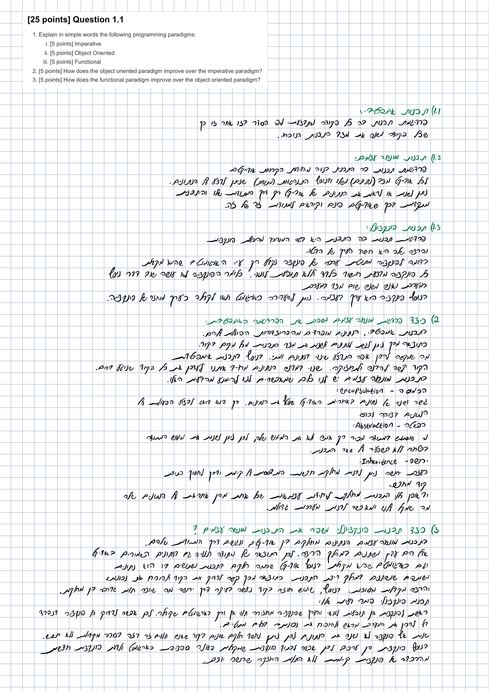

## Part 1: Theoretical Questions

Submit the solution to this part as `part1.md`.

### [25 points] Question 1.1

1. Explain in simple words the following programming paradigms:
   1. [5 points] Imperative
   2. [5 points] Object Oriented
   3. [5 points] Functional
2. [5 points] How does the object oriented paradigm improve over the imperative paradigm?
3. [5 points] How does the functional paradigm improve over the object oriented paradigm?

**Answer (handwritten):** see also `HW1Q1.pdf` / `HW1Q1.png`.



**Answer (typed):**

#### 1.1) תכנות אימפרטיבי:

פרדיגמת תכנות בה כל פקודה מתבצעת לפי הסדר זו אחר זו כך שכל פקודה משנה את מצב התכנית הנוכחי.

#### 1.2) תכנות מונחה עצמים:

פרדיגמת תכנות בה התכנית בנויה מיחידות הקרויות אובייקטים

לכל אובייקט מצב (נתונים) משלו ובנוסף התנהגויות (מתודות) שניתן לבצע על הנתונים.

ניתן לשנות או לראות את הנתונים של אובייקט רק דרך המתודות שלו והתכנית מתקדמת בכך שאובייקטים פונים וקוראים למתודות זה של זה.

#### 1.3) תכנות פונקציונלי:

פרדיגמת תכנות בה התכנית היא ביטוי המורכב מהפעלת פונקציות והרצה שלה היא חישוב הערך של הביטוי.

בדומה לפונקציה מתמטית ערכה של פונקציה נקבע רק ע"י הארגומנטים שהיא מקבלת.

כל פונקציה מבצעת חישוב בלבד ללא תופעות לוואי. כלומר הפונקציה לא עושה שום דבר נוסף במערכת ואינה משנה שום מצב במערכת

בנוסף פונקציה היא ערך בעצמה. ניתן להעבירה כארגומנט ו/או לקבלה כערך מוחזר של פונקציה.

#### 2) כיצד פרדיגמת מונחה עצמים משפרת את הפרדיגמה האימפרטיבית:

בתכנות אימפרטיבי, הנתונים מופרדים מהפרוצדורות הפועלות עליהם.

כתוצאה מכך ניתן לגשת לנתונים ולשנות את מצב התכנית מכל מקום בקוד.

מה שמקשה להבין איפה התבצע שינוי בנתונים ומתי. בנוסף בתכנות אימפרטיבי הקוד קשה להרחבה ולתחזוקה. שינוי במבנה הנתונים מחייב אותנו לעדכן את כל הקוד שנוגע בהם.

בתכנות מונחה עצמים יש לנו כלים שמאפשרים לנו להימנע מהבעיות האלו.

**הכמסה - Encupsulation:**

גישה ושינוי של נתונים באחריות האובייקט שמחזיק את הנתונים. רק הוא דואג לביצוע הפעולות על הנתונים בצורה נכונה

**הפשטה - Abstraction:**

מי שמשתמש במתודה מכיר רק אותה ולא את המימוש שלה, לכן ניתן לשנות את מימוש המתודה בבטחה ללא השפעה על שאר התכנית.

**ירושה - Inheritence:**

בעזרת ירושה ניתן לבנות מחלקות חדשות המתבססות על קיימות ובכך לחסוך כתיבת קוד מחדש.

ובאופן כללי התכנית מחולקת ליחידות עצמאיות שכל אחת מהן אחראית על הנתונים שלה מה שמקל עלינו ומאפשר לבנות מערכות גדולות.

#### 3) כיצד תכנות פונקציונלי משפר את התכנות מונחה עצמים?

בתכנות מונחה עצמים הנתונים מחולקים בין אובייקטים ונגישים דרך המתודות שלהם, אך הם עדיין משתנים במהלך הריצה. לכן התוצאה של מתודה תלויה גם בנתונים השמורים באובייקט וגם בארגומנטים שהיא מקבלת. בנוסף אובייקט שכמה חלקים בתכנית משתמשים בו הוא נתונים משותפים שמשתנים במהלך ריצת התכנית. כתוצאה מכך קשה לבדוק את הקוד ולהוכיח את נכונותו והרצה מקבילית מסוכנת. בנוסף, שימוש חוזר בקוד נעשה בעיקר דרך ירושה מה שיוצר תלות גבוהה בין מחלקות.

תכנות פונקציונלי פותר בעיות אלו:

ראשית לפונקציות אין תופעות לוואי והערך שפונקציה מחזירה תלוי אך ורק בארגומנטים שקיבלה. לכן אפשר לבדוק כל פונקציה בנפרד בלי להכין את המערכת מראש ולהוכיח את נכונותה בכלים מתמטיים.

שנית אף פונקציה לא משנה את הנתונים לכן ניתן לחשב חלקים שונים בקוד שאינם תלויים זה בזה בצורה מקבילית ללא חשש.

בנוסף פונקציות הן ערכים לכן אפשר לכתוב פונקציות שמקבלות פעולה ספציפית כארגומנט ולבנות פונקציות חדשות מהרכבה של פונקציות קיימות ללא התלות ההדוקה שירושה יוצרת.

### [10 points] Question 1.2

Consider the following TypeScript function, which calculates the average price of all discounted products in a given inventory.

```ts
type Product = {
  name: string;
  price: number;
  discounted: boolean;
};

const getDiscountedProductAveragePrice = (inventory: Product[]): number => {
  let discountedPriceSum = 0;
  let discountedProductsCount = 0;

  for (const product of inventory) {
    if (product.discounted) {
      discountedPriceSum += product.price;
      discountedProductsCount++;
    }
  }

  if (discountedProductsCount === 0) {
    return 0;
  }

  return discountedPriceSum / discountedProductsCount;
};
```

This function uses an imperative approach with loops and conditional statements.

Refactor the function `getDiscountedProductAveragePrice` to adhere to the Functional Programming paradigm. Utilize the built-in array methods `map`, `filter`, and `reduce` to achieve the same functionality without explicit iteration and conditional checks.
Write the new function under the name `getDiscountedProductAveragePriceFP`.

**Important**: the new function should have the same signature.

**Note**: there are no tests for this question, and it will not be executed. The task here is to write the code in a functional way.

**Solution:**

```ts
type Product = {
  name: string;
  price: number;
  discounted: boolean;
};

const getDiscountedProductAveragePriceFP = (inventory: Product[]): number => {
  const discounted = inventory.filter((x) => x.discounted);
  const prices = discounted.map((x) => x.price);
  const sumDiscounted = prices.reduce((acc, x) => acc + x, 0);
  const inDiscount = discounted.length;
  return inDiscount === 0 ? 0 : sumDiscounted / inDiscount;
};
```

### [18 points] Question 1.3

Write the most general type for each expression, using type variables where applicable.
Guidelines:

- Arrays must be homogeneous.
- Arithmetic operations must be performed on numbers.
- Use generics where possible.
- Avoid using `any`.

1. [3 points] `(x, y) => x.some(y)`
2. [3 points] `x => x.map(y => y * 2)`
3. [3 points] `(x, y) => x.filter(y)`
4. [3 points] `x => x.reduce((acc, cur) => acc + cur, 0)`
5. [3 points] `(x, y) => x ? y[0] : y[1]`
6. [3 points] `(f,g) => x => f(g(x+1))`

**Answers:**

```ts
1. <T>(x: T[], y: (a: T) => boolean) => boolean
2. (x: number[]) => number[]
3. <T>(x: T[], y: (a: T) => boolean) => T[]
4. (x: number[]) => number
5. <T>(x: boolean, y: T[]) => T
6. <T, U>(f: (a: U) => T, g: (x: number) => U) => (x: number) => T
```
